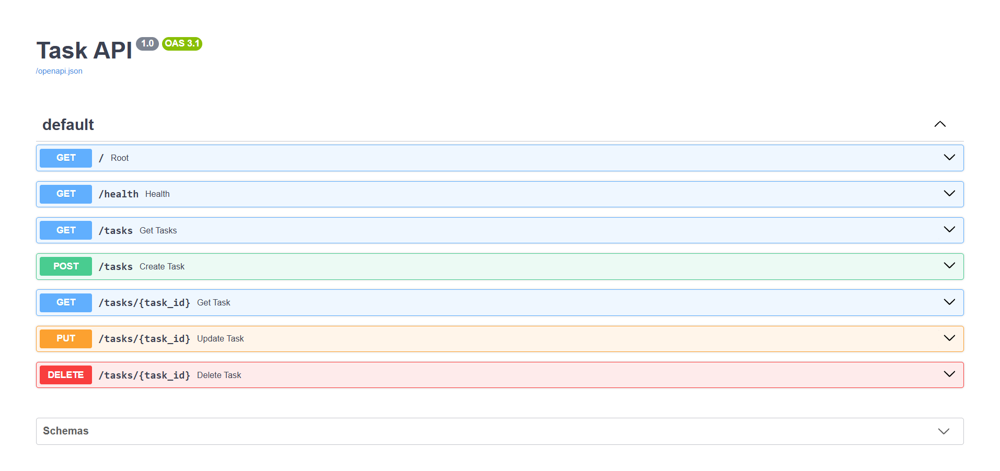
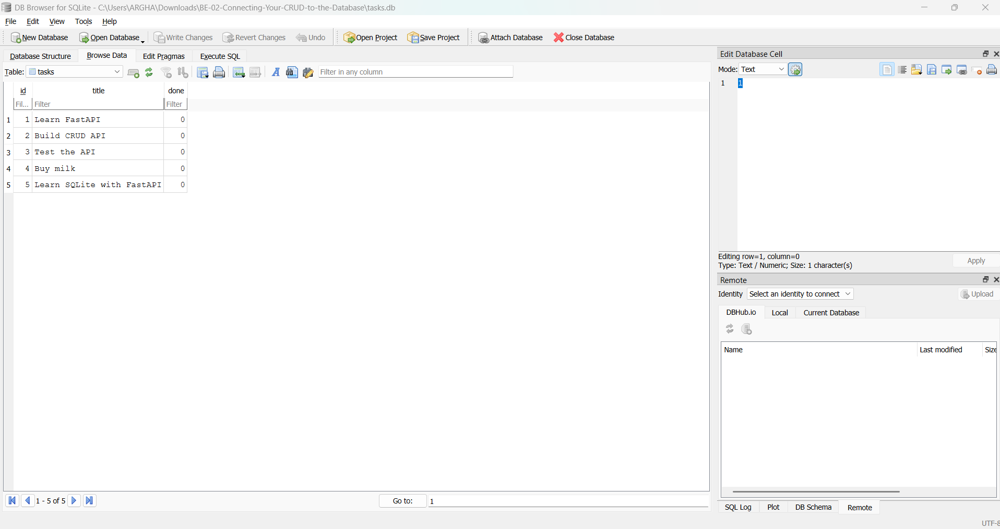

# Task API (SQLite Backend) - BE-02

Part 2 of the FlyRank Backend AI Engineering track. A lightweight CRUD API built with Python and FastAPI, featuring task management, input validation, interactive API documentation, and persistent SQLite database storage.

## Features

- Create tasks
- Read all tasks or a single task
- Update a task title and/or completion status
- Delete tasks
- Input validation and 404 error handling
- Interactive Swagger UI documentation
- Persistent SQLite storage with auto-seeding

## Requirements

- Python 3.10+
- FastAPI
- Uvicorn
- SQLite3

## Run locally

Install the dependencies:

```bash
pip install -r requirements.txt
```
Start the API server:

```bash
python -m uvicorn main:app --reload
```

The API will run at:

`http://localhost:8000`

Swagger UI is available at:

`http://localhost:8000/docs`

## API Endpoints

| Method |        Endpoint       |               Description                   |
|--------|-----------------------|---------------------------------------------|
| GET    |          `/`          | Get API information and available endpoints |
| GET    |       `/health`       |       Check whether the API is running      |
| GET    |       `/tasks`        |               Get all tasks                 |
| POST   |       `/tasks`        |             Create a new task               |
| GET    |   `/tasks/{task_id}`  |          Get a single task by ID            |
| PUT    |   `/tasks/{task_id}`  |            Update a task by ID              |
| DELETE |   `/tasks/{task_id}`  |            Delete a task by ID              |

## Example Request

### Create a task

```bash
curl -i -X POST http://localhost:8000/tasks \
  -H "Content-Type: application/json" \
  -d '{"title":"Buy milk"}'
```

Example response:

```text
HTTP/1.1 201 Created
date: Fri, 02 Oct 2026 11:51:14 GMT
server: uvicorn
content-length: 40
content-type: application/json

{"id":4,"title":"Buy milk","done":false}
```
## Interactive Documentation

The API utilizes FastAPI's built-in Swagger UI for interactive API documentation and live endpoint testing.

Open:

`http://localhost:8000/docs`



## Explored SQLite

The database was interacted with directly via DB Browser for SQLite to verify that the FastAPI application and the SQLite database share a single source of truth (`tasks.db`) with zero server restarts.

### Example Query

**Mark every task completed:**

```sql
UPDATE tasks SET done = 1;
```

**Response:**

```text
Execution finished without errors.
Result: query executed successfully. Took 6ms, 5 rows affected
At line 1:
UPDATE tasks SET done = 1;
```

- **Result:** Executed successfully and returned `query executed successfully. Took 6ms, 5 rows affected`, marking all tasks as completed (`done = 1`).
- **Note:** Clicking the **"Write Changes"** button in DB Browser was required to flush the pending transaction to the physical `tasks.db` disk file, allowing the running FastAPI server to reflect the updates instantly via `GET /tasks` with no server restarts.

## Database Architecture & Verification

### Database Architecture

**Why SQLite?**

SQLite was chosen for this backend project for several key reasons:

- **Single File Architecture:** The entire database resides in a single, lightweight file (`tasks.db`).
- **Zero Configuration:** Requires no external database servers, network configuration, or complex setup.
- **True Persistence:** Unlike in-memory storage, data survives application restarts, server reboots, and crashes.

**Database Location & Auto-Creation**

- **File Location:** The database file (`tasks.db`) is created automatically in the root directory of the project upon startup if it does not already exist.
- **Git Tracking:** `tasks.db` is included in `.gitignore` so that every clean clone starts fresh with automatic table creation and default seed data.

### Database Verification

**DB Browser Inspection:** 



## Project Structure

```text
BE-02-Connecting-Your-CRUD-to-the-Database/
├── main.py
├── requirements.txt
├── .gitignore
├── README.md
└── screenshots/
    ├──db_screenshot.png
    └── swagger-ui.png
```